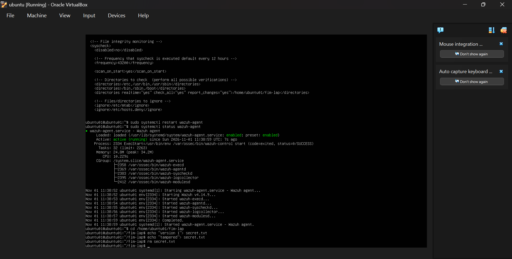
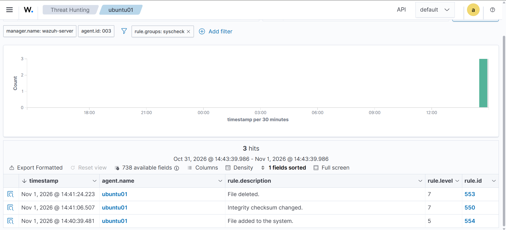
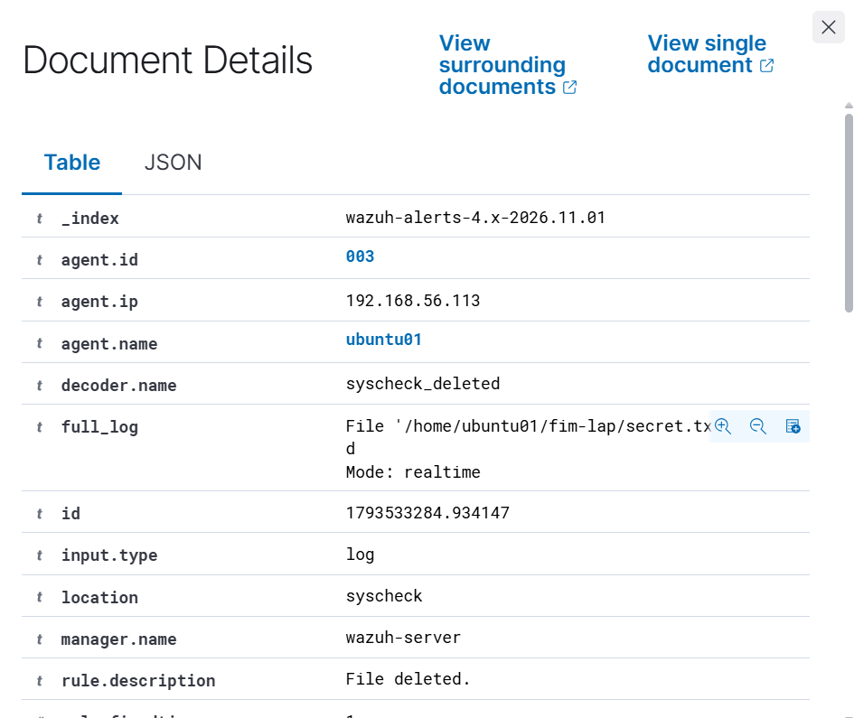
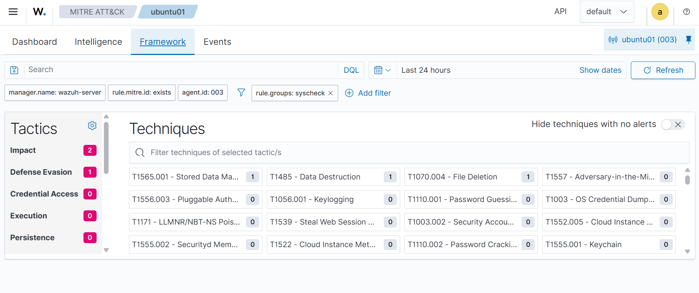
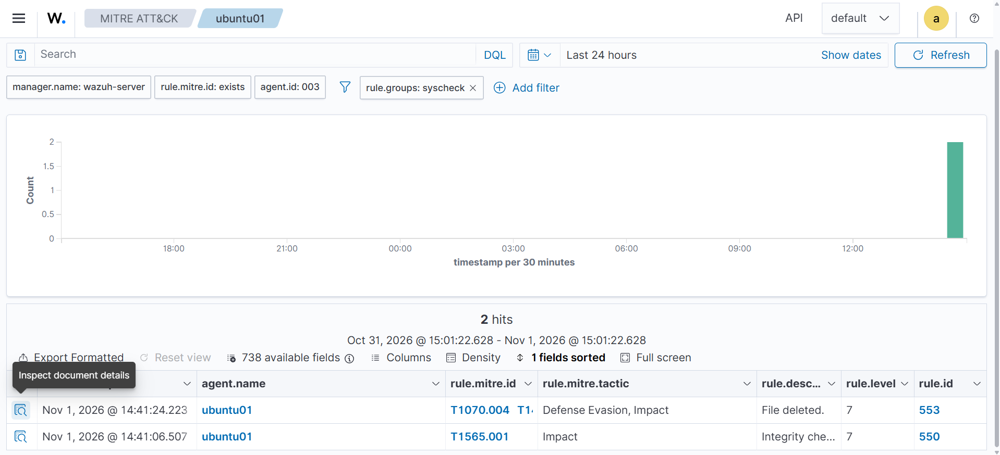

# Lab 05 - File Integrity Monitoring with Wazuh

**Date:** November 1, 2026
**Platform:** Ubuntu Server 24.04 (Wazuh agent 003, ubuntu01), Wazuh 4.14.9, Wazuh syscheck (FIM), MITRE ATT&CK

In Labs 03 and 04 I detected failed logins. Here I moved to a different question a SOC analyst asks: **did a file change on this host?** I configured Wazuh File Integrity Monitoring (FIM) on the Ubuntu endpoint, then added, modified and deleted a file in a watched folder and checked the alerts and their MITRE mapping.

| Step | What I did | Evidence |
|---|---|---|
| 1 | Configured syscheck to watch a test folder in real time | Screenshot 01 |
| 2 | Added, modified and deleted a file | Screenshot 01 |
| 3 | Found the three FIM alerts in Wazuh Threat Hunting | Screenshot 02 |
| 4 | Read the deleted-file alert | Screenshot 03 |
| 5 | Checked the MITRE ATT&CK mapping | Screenshots 04, 05 |

---

## Lab environment

Everything ran in my isolated VirtualBox host-only network (`192.168.56.0/24`).

| Machine | Role | Address |
|---|---|---|
| Ubuntu Server 24.04 (`ubuntu01`) | Monitored endpoint, Wazuh agent 003 | 192.168.56.113 |
| Wazuh server | Manager, Indexer and Dashboard (4.14.9) | 192.168.56.105 |

## 1. Configure File Integrity Monitoring

**Goal:** make the Wazuh agent watch a folder and report every change.

FIM is done by the agent's **syscheck** module. By default it already watches system folders such as `/etc`, `/usr/bin` and `/boot`, and it scans on a schedule (every 12 hours) and when the agent starts. I created a test folder, `/home/ubuntu01/fim-lap`, and added it to the `<syscheck>` block in `/var/ossec/etc/ossec.conf`:

```xml
<directories realtime="yes" check_all="yes" report_changes="yes">/home/ubuntu01/fim-lap</directories>
```

| Option | Meaning |
|---|---|
| `realtime="yes"` | Report changes immediately instead of waiting for the next scheduled scan |
| `check_all="yes"` | Check all attributes: size, permissions, owner, modification time and hashes |
| `report_changes="yes"` | Record what changed inside text files |

I restarted the agent and confirmed it was running:

```bash
sudo systemctl restart wazuh-agent
sudo systemctl status wazuh-agent
```

The status showed **active (running)**, with `wazuh-syscheckd` among the agent processes.

## 2. Make the changes

Inside the monitored folder I created a file, changed its content, and deleted it:

```bash
cd /home/ubuntu01/fim-lap
echo "version 1" > secret.txt    # file added
echo "tampered" > secret.txt     # file modified
rm secret.txt                    # file deleted
```



**What I learned:** the folder must exist before the agent starts if it is to be watched in real time, and the monitoring is configured on the agent, not on the Wazuh server.

## 3. Find the alerts in Wazuh

In **Threat Hunting** I selected agent `ubuntu01` (`agent.id: 003`) and filtered on `rule.groups: syscheck`. The dashboard returned exactly **3 hits**, one for each action, within seconds of the commands.



| Time (Nov 1, 2026) | Action | Rule ID | Level | Description |
|---|---|---|---|---|
| 14:40:39 | File created | 554 | 5 | File added to the system |
| 14:41:06 | File modified | 550 | 7 | Integrity checksum changed |
| 14:41:24 | File deleted | 553 | 7 | File deleted |

New files are reported at level 5. Changing or removing an existing file is reported at **level 7**, which is a higher priority for an analyst.

## 4. Read the alert

I opened the deleted-file alert. The decoder is `syscheck_deleted`, the location is `syscheck`, and the full log names the file and shows how it was detected:



| Field | Value | Meaning |
|---|---|---|
| `agent.name` / `agent.id` | ubuntu01 / 003 | Which host changed |
| `agent.ip` | 192.168.56.113 | Address of that host |
| `decoder.name` | syscheck_deleted | FIM decoder for a deleted file |
| `full_log` | File '/home/ubuntu01/fim-lap/secret.txt' deleted. Mode: realtime | Which file, and that it was caught in real time |
| `rule.description` | File deleted. | Rule 553 |

**What I learned:** a FIM alert answers "which host, which file, what happened and when" directly, which is the first thing to establish when triaging.

## 5. MITRE ATT&CK mapping

I opened **MITRE ATT&CK** for agent `ubuntu01`, filtered on `rule.groups: syscheck`.





| Rule | Technique | Tactic |
|---|---|---|
| 550 (modified) | T1565.001 Stored Data Manipulation | Impact |
| 553 (deleted) | T1070.004 File Deletion | Defense Evasion |
| 553 (deleted) | T1485 Data Destruction | Impact |
| 554 (added) | No MITRE mapping shown | - |

The Events view with `rule.mitre.id: exists` returned only **2 hits** (rules 553 and 550), so the "file added" alert carries no MITRE tag. In the Framework view the tactic counts were Impact 2 and Defense Evasion 1.

**Reading the mapping:** these tags match how attackers behave. Changing stored data or configuration files is Impact. Deleting files to hide activity is Defense Evasion. But the tags come from the rule authors, not from the intent of the person who changed the file. My own harmless test triggered them too, so an analyst has to check the context before calling a change malicious.

## 6. Analyst triage notes

| Question | Answer from the alerts |
|---|---|
| What happened? | A file was created, changed and deleted in a monitored folder |
| Which host? | ubuntu01 (agent 003) |
| Which file? | /home/ubuntu01/fim-lap/secret.txt |
| How fast was it detected? | Within seconds, in real-time mode |
| How severe? | Level 5 for the new file, level 7 for the change and the deletion |
| Was it malicious? | No. It was my own test in the lab |

In a real incident I would ask who made the change (a user, a package update or an attacker), whether it matches a change ticket, and whether other files changed around the same time.

## 7. Hardening recommendations

- Monitor sensitive paths in real time: `/etc`, SSH keys and configuration, web roots and system binaries.
- Keep a record of approved changes so planned updates can be separated from suspicious ones.
- Treat a change to a system binary or a deletion of a log file as high priority, and investigate it.
- Forward FIM alerts to the central SIEM, so an attacker who deletes local files cannot also erase the evidence.

## Notes

- The test folder is named `fim-lap` (a typo for `fim-lab`). It does not affect the results, because the configuration and the commands use the same name.
- I overwrote the file with `>` for the second command instead of appending. Either way the content changed, so the checksum changed and rule 550 fired.
- I did not capture the content diff that `report_changes` records, so I do not show it here.

## Summary of skills shown

- Configuring Wazuh syscheck and real-time File Integrity Monitoring on a Linux agent
- Generating safe, controlled file changes to test detection
- Finding and interpreting FIM alerts (rules 554, 550 and 553) in Wazuh Threat Hunting
- Reading MITRE ATT&CK mappings and noticing where an alert has none
- Writing triage notes and hardening recommendations

All testing was done on my own machines, inside my isolated lab network.
